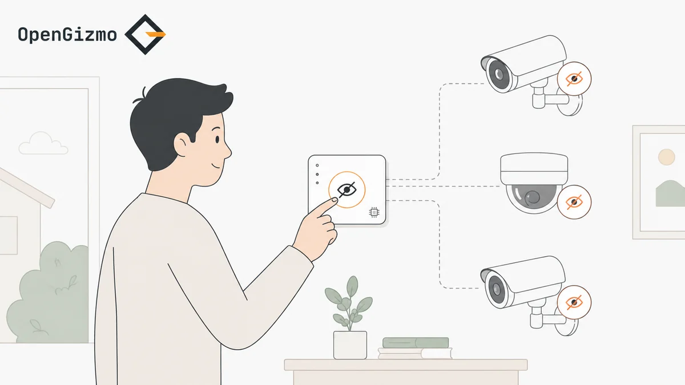
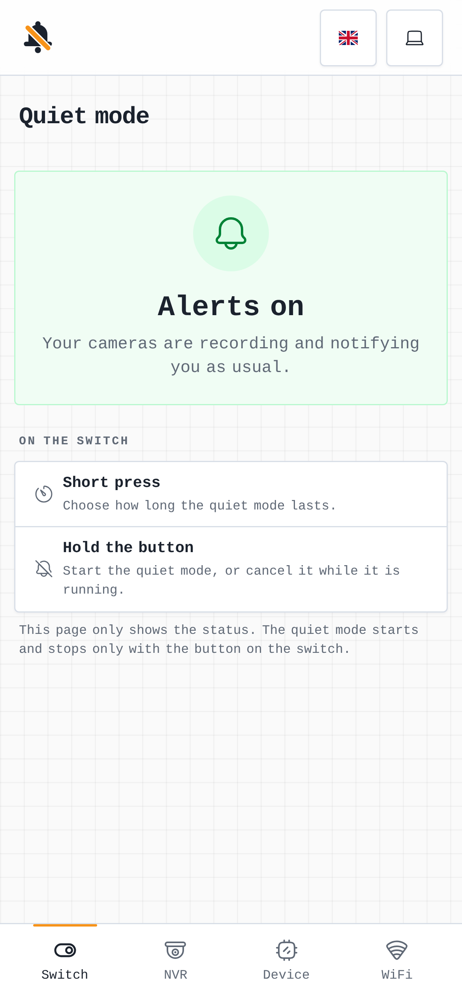
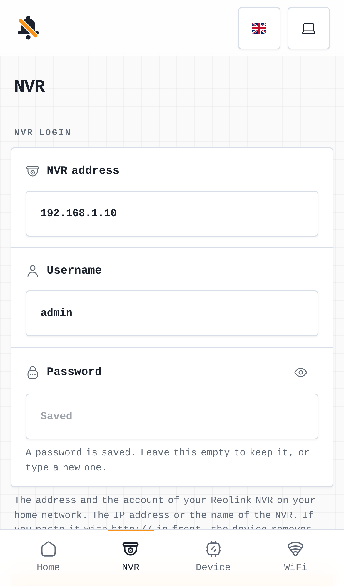
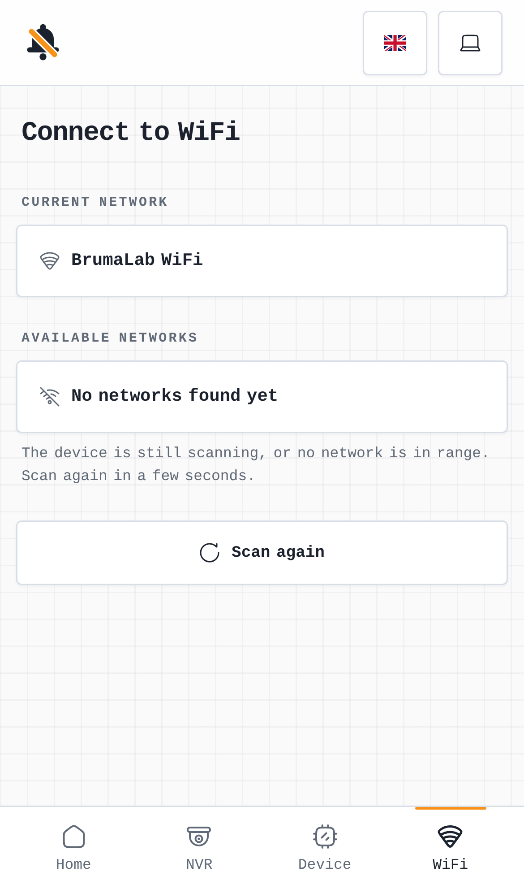
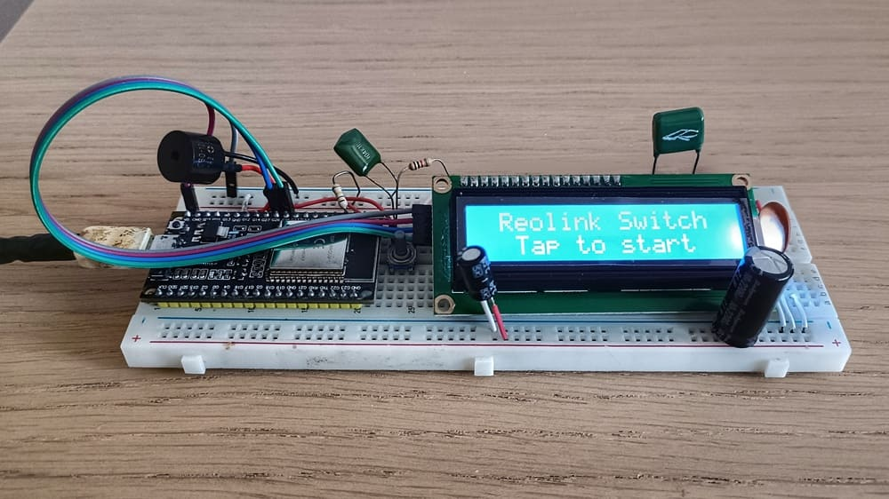

<div align="center">

# 🔕 Gizmo Reolink Switch

### An ESP32-powered quiet-exit switch for Reolink NVR systems

Gizmo Reolink Switch is a small ESP32 project that lets you temporarily mute Reolink NVR notifications and recording so you can leave home without triggering your own cameras. It combines a one-button interface, buzzer feedback, a 16x2 I2C LCD, a web dashboard for your phone, and direct Reolink API control. Everything is set up from the phone: no code, no credentials in the firmware.

<p>
  <a href="https://opengizmo.dev/projects/gizmo-reolink-switch"></a>
</p>

<p>
  
  
  
  
  
  
  
</p>

<p>
  🏠 Quiet exit workflow • 📱 Web dashboard • 📺 Friendly 16x2 LCD UI • 🔔 Buzzer feedback • 📡 Wi-Fi setup from your phone • 🎥 Reolink NVR muting and restore
</p>

<p>
	<a href="#overview"><strong>Overview</strong></a> •
	<a href="#images"><strong>Images</strong></a> •
	<a href="#features"><strong>Features</strong></a> •
	<a href="#architecture"><strong>Architecture</strong></a> •
	<a href="#quick-start"><strong>Quick Start</strong></a> •
	<a href="#hardware"><strong>Hardware</strong></a> •
	<a href="#firmware-overview"><strong>Firmware Overview</strong></a> •
	<a href="#configuration"><strong>Configuration</strong></a> •
	<a href="#troubleshooting"><strong>Troubleshooting</strong></a> •
	<a href="#license"><strong>License</strong></a>
</p>

</div>

<a id="overview"></a>
## 📘 Overview

This project is designed for a simple real-world problem: you want to leave the house without generating useless Reolink alerts or recordings from your own movement.

The firmware runs on an ESP32 and gives you a compact standalone interface:

- Short press the button to choose a mute duration.
- Long press to start the countdown. A short press while it runs shows how to cancel it.
- The ESP32 connects to WiFi and tells the Reolink NVR to disable notifications and recording on active channels.
- When the timer finishes, or when you cancel it, the firmware turns notifications and recording back on for the channels it muted.

The quiet mode is only controlled from the button, on purpose: nobody can mute your cameras without being at the switch. The web dashboard on the device sets it up (the Wi-Fi and the NVR login) and shows its status and the countdown, but can't start, cancel or retry the quiet mode.

The device also provides:

- A buzzer for immediate feedback.
- A 16x2 LCD with clear user-facing status screens.
- Serial logs for development and troubleshooting.

<a id="images"></a>
## 🖼️ Images

### Screenshots

<div align="center">
	<table>
		<tr>
			<td align="center" valign="top">
				
			</td>
			<td align="center" valign="top">
				
			</td>
			<td align="center" valign="top">
				
			</td>
		</tr>
	</table>
	<p>
		<sub>Switch, NVR, and WiFi setup screens (the web app's development server, with a mock switch)</sub>
	</p>
</div>

### Prototype

<div align="center">
	
	<p>
		<sub>Prototype build of Gizmo Reolink Switch</sub>
	</p>
</div>

<a id="features"></a>
## ✨ Features

- One-button interface with short-press and long-press actions.
- Smart timer selection: `+1 minute` below 5 minutes, then `+5 minutes` increments, up to 60 minutes. One more press goes back to zero, so an overshoot can be fixed without starting the timer.
- Web dashboard built into the firmware: set the NVR up and watch the status and the countdown from any phone on your network. It never controls the cameras: the quiet mode starts, stops and restores from the button only.
- Setup without code: the Wi-Fi is set from a setup hotspot with a captive portal, and the NVR address and login from the dashboard, which tests the connection and counts the online cameras. The password is write-only: the dashboard never gets it back, and changing the NVR's address or username clears it, so it's only ever sent to the NVR it was entered for.
- Factory reset: hold the board's BOOT button for 10 seconds (the LCD counts down) to forget the Wi-Fi and the NVR login. It's refused while cameras are muted, since the saved login is what restores them.
- Reolink integration using direct API calls from the ESP32.
- Automatic restore of notifications and recording when the timer ends, with retries if the NVR is unreachable or a muted camera is offline.
- Muted channels are saved in flash, so the cameras are restored even if the device reboots while they are muted.
- Friendly 16x2 I2C LCD screens optimized for quick readability, including the setup steps.
- Buzzer cues for selection, start, countdown warning, completion, and cancellation.
- A `debug` build profile with the serial log on (off in the released firmware).
- Native tests for the firmware logic, and Vitest tests for the dashboard.

<a id="architecture"></a>
## 🏗️ Architecture

Gizmo Reolink Switch is built around four cooperating parts:

- 🔌 **ESP32 firmware** handles the button, timer logic, buzzer feedback, Wi-Fi, LCD output, the web dashboard and its API, and the Reolink API calls.
- 🌐 **Nuxt web app** is the dashboard. It's built as a static site and embedded in the firmware, on the shared [gizmo-common](https://github.com/open-gizmo/gizmo-common) web layer.
- 📺 **16x2 I2C LCD** provides the status screens for setup, idle mode, countdown mode, and restore events.
- 🎥 **Reolink NVR** receives the API commands that mute and restore notifications and recording on active channels.

### 🔄 Data Flow

1. The user presses the button to choose a quiet-mode duration, and holds it to start or cancel the timer.
2. The firmware's main loop runs it (only the main loop talks to the NVR).
3. When quiet mode starts, the ESP32 authenticates with the Reolink NVR and disables notifications and recording on active channels.
4. While the timer runs, the LCD and the dashboard show the countdown, and the buzzer warns near the end.
5. When the timer completes or is cancelled, the ESP32 turns notifications and recording back on for the muted channels and returns to the idle screen.
6. If the restore fails, or a muted camera is offline, the LCD shows `Alerts Still OFF` and the dashboard a warning. The firmware retries every minute, and holding the button retries right away.

<a id="quick-start"></a>
## 🚀 Quick Start

### 🚀 Easy, no-code option

Use this path if you just want to flash the prebuilt firmware from the website. You do not need VS Code, PlatformIO, or a local build step.

1. **Connect the XIAO ESP32-S3 to a USB port of your computer.**

2. **Open the [Gizmo Reolink Switch](https://opengizmo.dev/projects/gizmo-reolink-switch) project page,** in Chrome or Edge.

3. **Press the "Flash firmware" button in the firmware card, and wait until it completes.**

	The board restarts into the new firmware by itself, and keeps its saved Wi-Fi and NVR login.

4. **Connect the switch to your Wi-Fi.**

	On the first boot there's no saved network, so the LCD shows `Join Wi-Fi Setup` and the switch opens an open hotspot called `Gizmo-Reolink`. Join it with your phone, and the setup page opens by itself: pick your network and type its password.

5. **Set up the NVR.**

	The LCD now shows `Set Up NVR` and the address of the switch. Open it in the browser (or `http://gizmo-reolink-switch.local/`), go to the **NVR** page, and enter the address, username and password of your NVR. The switch checks the login and shows how many cameras are online.

6. **Leave home quietly.**

	Press the button to choose the time and hold it to start. The dashboard's **Switch** page shows the countdown.

### 🛠️ More technical option

If you want to build and flash everything yourself, follow this path:

1. **Install Visual Studio Code and PlatformIO.**

	Clone the repository and open it in VS Code, then install the PlatformIO extension (or PlatformIO Core) so you can build and upload the firmware. The firmware project lives in `microcontroller/`, and PlatformIO uses the settings defined in `microcontroller/platformio.ini`.

	```bash
	git clone https://github.com/open-gizmo/gizmo-reolink-switch.git
	```

2. **Build the app UI first.**

	The web app lives in `webapp/` and needs Node.js 24.21 or newer. From that folder, install the exact dependencies of the lockfile and build the embedded dashboard:

	```bash
	npm ci
	npm run build:embedded
	```

	This runs the Nuxt static build, then the `gizmo-embed` tool from [gizmo-common](https://github.com/open-gizmo/gizmo-common) turns it into gzipped C++ files in `microcontroller/src/webui/`. Re-run it any time you change the dashboard.

3. **Build and upload the firmware.**

	Open `microcontroller/` in the PlatformIO panel and click **Upload**, or from the CLI:

	```bash
	pio run --target upload
	```

	This builds the `release` profile. For the serial log, use `debug` instead (see [Build profiles](#build-profiles)):

	```bash
	pio run -e debug --target upload
	pio device monitor
	```

4. **Set up the Wi-Fi and the NVR from your phone,** as in steps 4 to 6 of the no-code option.

<a id="hardware"></a>
## 🔌 Hardware

### Board

The firmware targets the **Seeed Studio XIAO ESP32-S3** (PlatformIO board `seeed_xiao_esp32s3`), with its FPC antenna. Besides the board, the switch needs:

- 1 push button.
- 1 buzzer.
- A 16x2 I2C LCD with backpack, detected at `0x27`.
- A Reolink NVR reachable on the same network as the switch.

The XIAO has no antenna on the board: connect its FPC antenna to the U.FL connector, or it won't join the Wi-Fi.

### Pinout

Current pin assignments from the firmware configuration:

| Part | XIAO ESP32-S3 pad |
| --- | --- |
| LCD SDA | `D4` (GPIO5) |
| LCD SCL | `D5` (GPIO6) |
| Button (to GND) | `D0` (GPIO1) |
| Buzzer | `D1` (GPIO2) |
| LCD and buzzer power | `5V`, `GND` |

### Display

- Type: `16x2 I2C LCD`
- I2C address: `0x27`
- Driver library: `hd44780_I2Cexp`

The LCD intentionally shows concise, human-friendly screens rather than raw log output. Serial logs stay verbose for debugging, while the display stays simple and readable for everyday use.

<a id="firmware-overview"></a>
## 🔍 Firmware Overview

### ⚙️ General

The main firmware entry point is [src/main.cpp](microcontroller/src/main.cpp). It:

- Initializes all modules.
- Shows the setup steps until the Wi-Fi and the NVR are set up.
- Runs the NVR check the dashboard asks for, and publishes what the switch is doing for it.
- Polls the button.
- Updates the timer state machine.
- Keeps the LCD and buzzer in sync with the current state.

### 🧩 Firmware Layers

The firmware is split into focused modules under `src/`:

- 🔘 `button/` reads the physical button and emits semantic events.
- 🔔 `buzzer/` drives audible feedback.
- 📺 `display/` manages the LCD screens and layout.
- 🔐 `nvr/` saves the NVR login set from the dashboard in NVS, and checks the login the dashboard sends.
- 🛰️ `remote/` hands the dashboard's NVR check to the main loop, and publishes what the switch is doing for the dashboard.
- 🌐 `server/` serves the dashboard and its API, one file per endpoint.
- ⏱️ `menu/` implements timer selection and countdown state.
- 📡 `wifi/` runs the Wi-Fi setup hotspot and keeps the connection, with the shared gizmo-common library.
- 💾 `storage/` saves the muted push and recording settings in NVS so a reboot can't leave the cameras muted.
- 🧮 `channels/` keeps track of which setting is muted on which channel, from the answer to each NVR command.
- 🎥 `reolink/` authenticates against the NVR and toggles notifications and recording.
- 🧾 `serial/` turns development logs on in dev mode (logging itself comes from the shared [gizmo-common](https://github.com/open-gizmo/gizmo-common) library, like the `MM:SS` formatting).
- ⚙️ `config/` centralizes pins, timing values, network names, and display settings.

### 🎥 Reolink integration

The Reolink API logic lives in [src/reolink/reolink.cpp](microcontroller/src/reolink/reolink.cpp).

Current implementation highlights:

- HTTPS API calls from the ESP32.
- Session login and token reuse.
- Retry on expired session.
- Active-channel discovery.
- Batch updates for notifications and recording state.

The firmware mutes the active channels when quiet mode starts and turns them back on afterward. Restoring always sets notifications and recording to enabled: channels where you had disabled them on purpose come back enabled.

### 🧪 Tests

The hardware-free firmware logic is tested on your computer, no board needed:

```bash
cd microcontroller
pio test -e native
```

The tests live in [microcontroller/test/](microcontroller/test/). They build the logic modules against a small fake `Arduino.h` ([test/stubs/Arduino.h](microcontroller/test/stubs/Arduino.h)) whose `millis()` is a clock the tests control, so they can fast-forward the timer and even cross a `millis()` rollover instantly. They also cover the checks of the NVR login and of the dashboard commands.

The web app has its own tests (its pages, the mock switch API and the translations), with Vitest:

```bash
cd webapp
npm test
```

They live in [webapp/tests/](webapp/tests/), and [webapp/tests/README.md](webapp/tests/README.md) explains how they are built.

### 🌐 Web App Overview

The dashboard lives in `webapp/`. It's a Nuxt 4 app on the shared gizmo-common web layer, like the other OpenGizmo web apps:

- **Switch**: the state of the alerts, the countdown, and what the button does. It only shows the status: the quiet mode starts and stops with the button on the switch.
- **NVR**: the address and login of the NVR, and the connection check.
- **Device**: the device details, with restart and forget network.
- **WiFi**: change the network, and the setup page the hotspot opens.

`npm run dev` starts it with a mock server that behaves like the switch, so you can work on it without a board.

#### 🎨 UI System

The web app splits UI responsibilities between the shared packages and the app itself.

- `@brumaombra/ui-vintage` provides the reusable UI system.
- The gizmo-common web layer provides the dashboard layout, the Wi-Fi pages, the device card, and the mock device for the Wi-Fi and device routes.
- `webapp/app/pages/switch.vue` is the switch page, `webapp/app/pages/nvr.vue` the NVR page, `webapp/app/pages/device.vue` holds the device card, and `webapp/app/app.config.ts` sets the name, logo and navigation for the layer.
- `webapp/app/assets/css/main.css` imports the shared library and layer stylesheets.
- `webapp/app/composables/` keeps the switch API calls (`useSwitchApi.js`), the status polling and the quiet-mode state local to the app.

<a id="configuration"></a>
## ⚙️ Configuration

### Build profiles

[platformio.ini](microcontroller/platformio.ini) has the same three profiles as every OpenGizmo firmware:

- `release`, the default: the firmware the release workflow builds and the website flashes, with the serial log off.
- `debug`: the same firmware with the serial log on, and the ESP32 core's own messages. Flash it with `pio run -e debug --target upload`, then open `pio device monitor`.
- `native`: the tests of the hardware-free logic, on your computer (`pio test -e native`).

Nothing needs a secrets file: the Wi-Fi and the NVR login are set from the phone and saved on the board.

### Switch API

Every response has the OpenGizmo shape `{ errorId, errorMessage, data }`. Only requests from the dashboard's own page, under the switch's own name or address, are accepted, and through the setup hotspot only the Wi-Fi setup answers (see gizmo-common). No endpoint controls the cameras:

- `GET /api/status` returns the timer, the remaining time, whether alerts are still off, whether the switch is busy, the NVR state and the online cameras.
- `GET /api/nvr` returns the NVR address and username, and whether a password is saved (the password is never sent back).
- `POST /api/nvr` saves a new login and checks it. An empty password keeps the saved one only for the same address and username: a new address or username needs the password again (`invalid_nvr_field`, `password`), so the saved one is never sent anywhere else. It's refused while cameras are muted, so they are always restored by the NVR that muted them.
- `POST /api/nvr-test` checks the login again.
- The Wi-Fi setup and device routes come from gizmo-common.

### Firmware Defaults

The main shared constants live in [config.h](microcontroller/src/config/config.h) and [config.cpp](microcontroller/src/config/config.cpp), including:

- Pin assignments.
- The hostname and the name of the setup hotspot.
- Button debounce and long-press timing.
- HTTP timing and the NVR login pause.
- Timer step rules.
- Buzzer durations.
- LCD geometry and address.

### Runtime Flow

The switch is configured through its embedded web UI and local network flow.

1. The ESP32 starts in access point mode on first boot, as the `Gizmo-Reolink` network, and the LCD shows `Join Wi-Fi Setup`.
2. The setup page lets you pick the Wi-Fi network and enter its password from your phone.
3. The LCD shows `Set Up NVR` and the address of the switch, and the dashboard's **NVR** page saves the NVR login and checks it.
4. The firmware saves the network and the NVR login, and reuses them after reboot.
5. The switch can then be reached on the local network using `gizmo-reolink-switch.local` on supported setups.

### Key Files

- `microcontroller/src/config/config.h` and `config.cpp` for the pins, timings and hardware constants.
- `microcontroller/src/reolink/reolink.cpp` for the Reolink API calls.
- `microcontroller/src/server/endpoints/` for the switch API, one file per endpoint.
- `webapp/app/composables/useSwitchApi.js` for browser-to-device communication.

### Releasing a new version

Versions follow [semantic versioning](https://semver.org) (`vMAJOR.MINOR.PATCH`), in the `VERSION` file: a bug fix bumps the patch (1.0.1), a new feature that keeps the saved settings bumps the minor (1.1.0), and a change that resets the settings or needs new wiring bumps the major (2.0.0).

1. On `feature`, set the new version in `VERSION` and in `webapp/package.json` (`npm version X.Y.Z --no-git-tag-version` in `webapp/` updates its lockfile too), and move the notes under **Unreleased** in [CHANGELOG.md](CHANGELOG.md) under a `## vX.Y.Z - YYYY-MM-DD` heading.
2. Bring `main` up to `feature`.
3. Run the **Build & Release 📦** workflow by hand (Actions > Build & Release > Run workflow, on `main`). It checks the version is new and matches the web app, runs the tests, builds the web app and the firmware (which reports its version in `/api/device`), and creates the GitHub Release `vX.Y.Z` with the four flash parts and the notes of `CHANGELOG.md` (it stops before building anything when the version has no notes, or notes are left under Unreleased).
4. The same parts go to Cloudflare R2, with a `manifest.json` that lists each part and its flash address. The flash button on [opengizmo.dev](https://opengizmo.dev/projects/gizmo-reolink-switch) reads that manifest, so it always installs the latest release, and keeps the saved settings. The CDN caches the manifest for 60 seconds only, so the website offers a new release within a minute, with no purge.

The workflow only runs on `main`, and needs these secrets, on the repository or on the open-gizmo organization: `R2_ACCOUNT_ID`, `R2_ACCESS_KEY_ID`, `R2_SECRET_ACCESS_KEY` (an R2 API token limited to the bucket) and `R2_BUCKET`. It checks them first, and stops before releasing anything when one is missing.

<a id="troubleshooting"></a>
## 🧰 Troubleshooting

- LCD powers on but shows no text: verify SDA/SCL wiring and confirm the backpack address matches the configured `0x27`.
- Button press ignored: while the LCD shows `Connecting...` or a result, the firmware is talking to the NVR and drops presses on purpose (a late press would act on the next screen). Press again once the idle or countdown screen is back.
- Button does nothing: verify the wiring against the input mode expected by the firmware.
- Quiet mode does not start: open the dashboard's **NVR** page and check the connection there. It says whether the NVR can't be found or refused the login.
- The `Gizmo-Reolink` hotspot doesn't appear: it only opens when there's no saved network or the saved one fails to connect.
- `gizmo-reolink-switch.local` doesn't open: some networks and devices don't support mDNS. Use the IP address the LCD shows, or the one on the dashboard's Device page.
- `NVR Not Set` / `Use the web app`: no NVR login is saved yet. Open the dashboard and set it on the **NVR** page.
- The NVR page won't save: the login can't change while cameras are muted (they must be restored by the NVR that muted them). Wait for the timer to end, or cancel it with the button, and retry with the button if alerts are still off.
- NVR state does not restore: the LCD shows `Alerts Still OFF` and the firmware keeps retrying. Hold the button to retry right away, or flash the `debug` profile and read the serial log.
- `Partly Muted!` after starting the timer: the NVR refused some commands (for example recording on a channel without a disk). The muted settings are still restored at the end, and the refused ones were never changed.
- `Login Paused` / `Check password`: the NVR refused a login, so the firmware waits 10 minutes before trying again (repeated wrong-password logins can lock the NVR account). Fix the username or password on the dashboard's **NVR** page (saving a new login ends the pause), or wait.

<a id="license"></a>
## 📄 License

This project is licensed under the MIT License. See [LICENSE](LICENSE) for details.

---

<p align="center">
	
	<br/>
	<strong>Real projects. Real hardware. Real fun.</strong>
	<br/>
	<sub>A small corner of the internet for ESP32 builds that are useful, remixable, and actually fun to use.</sub>
</p>